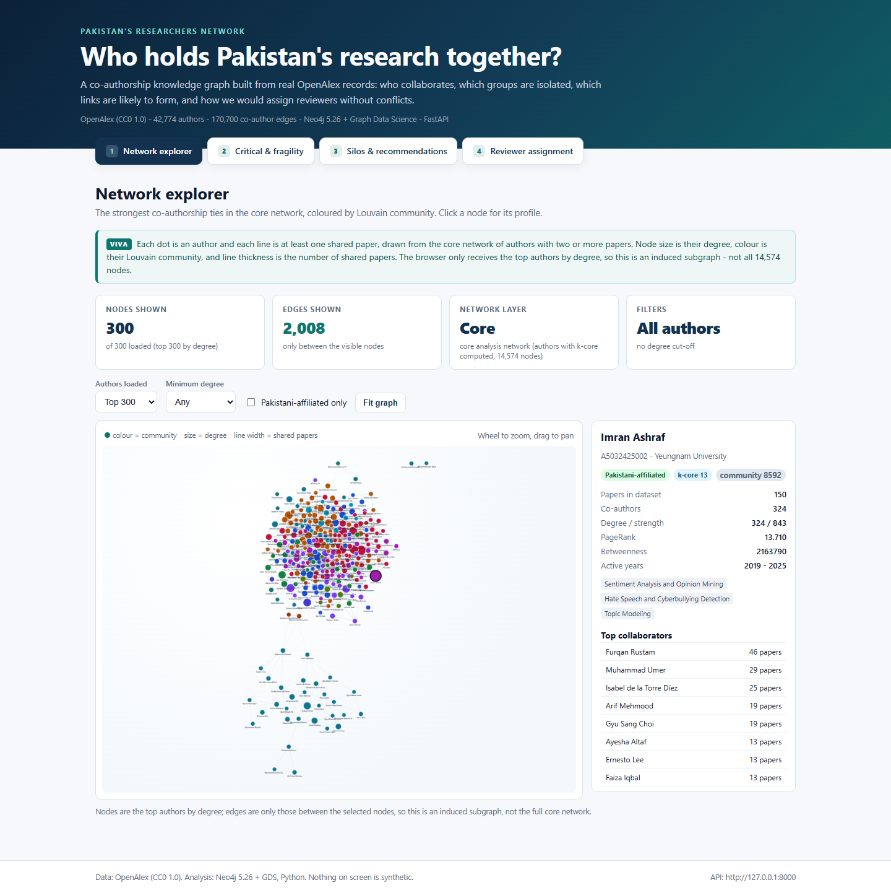

# Pakistan's Researchers Network

A research-collaboration knowledge graph built from **real OpenAlex data** (CC0 1.0),
stored and analysed in **Neo4j 5.26 + Graph Data Science**, served by a **FastAPI**
backend and explored in a **React + Cytoscape.js** frontend.

The project answers three questions:

1. **Fragility** — who holds the network together, and how fast does it break when
   key researchers are removed?
2. **Silos and collaboration prediction** — where are the isolated groups, and which
   new collaborations are most likely? Validated on a 2020/2021 time split.
3. **Reviewer assignment** — assign papers to well-matched reviewers under a
   per-reviewer workload cap and a conflict-of-interest rule, and compare with random
   assignment and the Hungarian algorithm.

No synthetic data is used. Every number in the report/UI comes from the submitted
dataset and a reproducible script.



---

## Dataset at a glance

| Measure | Real value |
|---|---:|
| Raw OpenAlex work records | **26,627** (136 pages, 2015–2025) |
| Clean papers | **26,188** |
| Authors | **42,774** (41,247 with at least one co-author) |
| Institutions / topics | **4,817 / 1,765** |
| `WROTE` / `CITES` edges | **109,066 / 40,735** |
| Co-authorship edges (full graph) | **170,700** |
| Largest connected component (full graph) | **79.7%** of collaborating authors |
| **Core analysis network** (≥2 papers and ≥1 co-author) | **14,574 nodes / 81,793 edges, LCC 92.6%** |

**Scope:** works with at least one Pakistani-affiliated institution
(`institutions.country_code:PK`), primary topic in Computer Science
(`fields/17`), published 2015–2025, types `article`, `proceedings-article`,
`review`, `book-chapter`. Preprints are excluded to avoid double-counting a
preprint and its published version.

**Why two graphs?** The full graph is loaded in Neo4j for transparency. The core
graph removes one-off authors (who cannot have a recurring collaboration pattern)
and the 61 authors who have two papers but no co-author, and is the network used
by Problems 1–3. Both are reported everywhere; this is a documented scope
refinement, not a hidden filter. Details:
[`data/graph_report.md`](data/graph_report.md).

### Source and licence

- **Source:** [OpenAlex](https://openalex.org), <https://api.openalex.org>.
- **Licence:** CC0 1.0 Universal (public domain dedication).
- **Citation:** Priem, J., Piwowar, H., & Orr, R. (2022). *OpenAlex: A fully-open
  index of scholarly works, authors, venues, institutions, and concepts.*
  arXiv:2205.01833.
- The crawler sends `mailto` from `OPENALEX_EMAIL` and a descriptive
  `User-Agent` (polite pool). The real email is **never** committed.

---

## Key results

### Problem 1 — fragility (core network)

| Metric | Value |
|---|---:|
| Articulation points / bridges | **670 / 660** |
| Maximum k-core | **16** |
| Node-disjoint paths, Imran Ashraf ↔ Tanzila Saba | **184** |
| LCC after removing 10% by betweenness | **76.3%** |
| LCC after removing 10% at random (20 runs) | **82.4%** |

Targeted removal is consistently worse than random, but the dense core prevents a
collapse. Full numbers: [`data/results/p1_fragility.json`](data/results/p1_fragility.json).

### Problem 2 — silos and link prediction

| Metric | Value |
|---|---:|
| Adamic-Adar AUC (2021+ test) | **0.6824** |
| Common-neighbours / Jaccard AUC | 0.6291 / 0.5945 |
| New 2021+ collaborations between training authors | 13,188 |
| Evaluated positives (shared-neighbour candidates) | **2,787 / 228,127** (1.22%) |
| Louvain communities / modularity | **546** / 0.6234 GDS (0.6927 NetworkX) |
| Silos (≥20 authors, ≥90% internal ties) | **3** (92.4%, 93.3%, 100% internal) |

The model is trained only on collaborations up to 2020 and tested on links that
really formed in 2021–2025. Full numbers:
[`data/results/p2_silos_linkprediction.json`](data/results/p2_silos_linkprediction.json).

### Problem 3 — reviewer assignment

| Metric | Min-cost flow | Hungarian | Random (100 runs) |
|---|---:|---:|---:|
| Coverage | **100%** (1,200/1,200) | 100% | 100% |
| Mean relevance | **0.4060** | 0.4221 | 0.0182 |
| Best reviewer per paper | 0.4739 | 0.4221 | 0.0448 |
| Maximum load | **3** | 1 | 3 |
| COI violations | **0 / 3,600** | 0 | 0 |

Flow keeps the Hungarian first choice in **92.5%** of papers while adding two more
valid reviewers. Full numbers:
[`data/results/p3_reviewers.json`](data/results/p3_reviewers.json).

---

## Architecture

```
OpenAlex API
    |  crawler/ (fetch -> clean -> build)
    v
data/cleaned/  CSV + GraphML  ----->  Neo4j 5.26 + GDS
    |                                    |  Cypher / GDS
    |                                    v
    +--> analysis/ (Python)  ----->  data/results/*.json|csv
                                         |
                                         v
                                   FastAPI backend  --->  React frontend
```

**What runs where (honest boundary):**

| Technique | Type | Implemented in |
|---|---|---|
| Degree / strength, degree distribution | Network science | Neo4j properties + Python plot |
| PageRank | Network science | Neo4j GDS `gds.pageRank` |
| Betweenness centrality (exact Brandes) | Network science | Neo4j GDS `gds.betweenness` |
| Articulation points and bridges | Graph theory | Neo4j GDS |
| k-core decomposition | Network science | Neo4j GDS |
| Louvain communities + modularity | Network science | Neo4j GDS (+ NetworkX cross-check) |
| Link prediction (Adamic-Adar, CN, Jaccard) | Network science | GDS nodeSimilarity candidates + Python scoring/evaluation |
| Targeted vs random failure cascade | Network science | Python (GDS has no cascade simulation) |
| Configuration-model null model | Network science | Python / NetworkX |
| Min-cost flow / Hungarian assignment | Graph theory | Python / SciPy + NetworkX |
| Minimum vertex cut / max-flow equivalence | Graph theory | Python / NetworkX (Menger check) |
| Shortest paths (collaboration distance) | Graph theory | Python / NetworkX BFS sampling |

Seeds are fixed (`SEED = 42`); the random baseline averages 100 seeded runs.

---

## Repository layout

```
researchers-network/
  AGENTS.md                  project rules (read this first)
  README.md                  this file
  docker-compose.yml         Neo4j 5.26 + GDS
  .env.example               environment template (copy to .env)
  pyproject.toml             Python package, dependencies, pytest/ruff config
  run_all.ps1 / run_all.sh   stage-selectable pipeline runner
  crawler/                   fetch_openalex.py, clean.py, build_graph.py, cli.py
  analysis/                  load_neo4j.py, p1_fragility.py, p2_silos_linkpred.py,
                             p3_reviewers.py, common/, cli.py
  backend/                   FastAPI app factory, routers, store, Neo4j gateway
  frontend/                  Vite + React + Cytoscape UI (4 views)
  tests/                     pytest suite (27 tests; live-Neo4j test skips)
  data/
    raw/                     JSON pages exactly as fetched + manifest
    cleaned/                 CSV node/edge lists + graphml/
    import/                  CSVs mounted at /import in the Neo4j container
    results/                 analysis JSON/CSV (served by the API)
    data_dictionary.md       every node/edge attribute
    cleaning_report.md       before/after cleaning statistics
    graph_report.md          graph construction + connectivity
  report/
    figures/                 11 analysis figures
    screenshots/             4 UI screenshots + CHECKLIST.md
  docs/
    PLAN.md                  stage plan and acceptance checks
    EXPLAIN.md               plain-language viva guide (start here to revise)
```

---

## Prerequisites

| Tool | Version | Notes |
|---|---|---|
| Python | 3.11+ | developed with 3.13.5 |
| Docker Desktop + Compose v2 | current | Neo4j 5.26 + GDS plugin |
| Node.js + npm | Node 18+ | developed with Node 24 / npm 11 |
| Disk | ~2 GB | raw cache + GraphML + Neo4j volume |
| Network | only for crawling | the submitted `data/raw` allows an offline rerun |

Windows PowerShell note: if `npm` is blocked by the execution policy
(`npm.ps1 cannot be loaded`), use `npm.cmd` instead, or run
`Set-ExecutionPolicy -Scope Process RemoteSigned` in the current terminal.

---

## Setup

### 1. Environment file

```powershell
Copy-Item .env.example .env
# edit .env: set OPENALEX_EMAIL to your real address; set the Neo4j password
```

Never commit `.env`. `.env.example` contains placeholders only.

### 2. Python environment

```powershell
python -m venv .venv
.\.venv\Scripts\python.exe -m pip install --upgrade pip
.\.venv\Scripts\python.exe -m pip install -e ".[dev]"
```

Linux/macOS: `.venv/bin/python -m pip install -e ".[dev]"`.

This installs the `rn-crawl` and `rn-analysis` commands, but every command below
also works as `python -m ...` from the repository root.

### 3. Frontend dependencies

```powershell
cd frontend
npm install        # or npm.cmd install on Windows
cd ..
```

---

## Run everything

### One command (recommended)

```powershell
# Full pipeline from the submitted raw data (no network needed)
.\run_all.ps1 -Stage all -SkipFetch

# Full pipeline including a fresh OpenAlex crawl
.\run_all.ps1 -Stage all
```

`-Stage all` runs data → Neo4j → all three analyses → tests → frontend build →
backend import check. It does **not** leave the API or dev server running; the
commands are printed at the end.

Useful flags:

| Flag | Effect |
|---|---|
| `-SkipFetch` | reuse `data/raw`; run clean + build + validate only |
| `-ResetNeo4j` | pass `--reset` to the loader (deletes existing nodes/projections) |
| `-SkipNull` | skip the Problem 1 rewiring null model (faster) |
| `-ForceFrontendInstall` | run `npm install` even if `node_modules` exists |
| `-Stage data` / `neo4j` / `analysis` / `test` / `frontend` / `backend` | run one stage |

Linux/macOS equivalent:

```bash
./run_all.sh --stage all --skip-fetch
```

> If PowerShell blocks the script:
> `powershell -ExecutionPolicy Bypass -File .\run_all.ps1 -Stage all -SkipFetch`.

### 1. Data — crawl, clean, build (Stage 1)

```powershell
.\.venv\Scripts\python.exe -m crawler.cli status     # what is cached
.\.venv\Scripts\python.exe -m crawler.cli fetch      # resumable OpenAlex download
.\.venv\Scripts\python.exe -m crawler.cli clean      # JSON -> CSV + cleaning report
.\.venv\Scripts\python.exe -m crawler.cli build      # co-authorship graph + GraphML
.\.venv\Scripts\python.exe -m crawler.cli validate   # grading requirements
# or all four: python -m crawler.cli all
```

Outputs: `data/raw/`, `data/cleaned/*.csv`, `data/cleaned/graphml/*.graphml`,
`data/cleaning_report.md`, `data/graph_report.md`, `data/results/stage1_*.json`.

`fetch` is resumable: existing pages are not downloaded again. A rerun with
`OPENALEX_API_KEY` set is safer if OpenAlex rate-limits the shared anonymous pool.

### 2. Neo4j — load and verify (Stage 2)

```powershell
docker compose up -d
docker compose ps                    # wait for "healthy"
.\.venv\Scripts\python.exe -m analysis.load_neo4j
```

The loader copies the CSVs into `data/import`, creates 4 constraints and 4
indexes, MERGEs all nodes/relationships, compares Neo4j counts with the CSV rows,
and creates two GDS projections: `authorGraphFull` (42,774 nodes) and
`authorGraph` (the 14,574-node core).

Quick checks in Neo4j Browser (<http://localhost:7474>):

```cypher
MATCH (a:Author) RETURN count(a);                 // 42774
MATCH ()-[r:CO_AUTHORED]->() RETURN count(r);     // 170700
CALL gds.graph.list();
RETURN gds.version();                             // 2.13.x
```

Useful flags: `--reset` (delete all data first), `--skip-gds`, `--gds-only`.

### 3. Analyses (Stages 3–5)

```powershell
.\.venv\Scripts\python.exe -m analysis.p1_fragility
.\.venv\Scripts\python.exe -m analysis.p2_silos_linkpred
.\.venv\Scripts\python.exe -m analysis.p3_reviewers
# or: python -m analysis.cli all
```

| Script | Needs | Outputs |
|---|---|---|
| `p1_fragility.py` | Neo4j + GDS | `p1_fragility.json`, `p1_critical_authors.csv`, 5 figures |
| `p2_silos_linkpred.py` | Neo4j + GDS | `p2_silos_linkprediction.json`, `p2_top_recommendations.csv`, 3 figures |
| `p3_reviewers.py` | CSV files only | `p3_reviewers.json`, `p3_reviewer_assignments.csv`, `p3_method_comparison.csv`, 3 figures |

Every script can load its input from the submitted CSVs/GraphML; nothing depends
on hidden state. Re-running overwrites the outputs (idempotent).

### 4. Backend (Stage 6)

```powershell
.\.venv\Scripts\python.exe -m uvicorn backend.main:app --reload --port 8000
```

- Interactive docs: <http://127.0.0.1:8000/docs>
- Health: <http://127.0.0.1:8000/api/health>

| Endpoint | Source |
|---|---|
| `GET /api/health` | files present + Neo4j status |
| `GET /api/stats` | Stage 1 + Stage 2 verification |
| `GET /api/network?limit=300` | Neo4j (degree-ranked induced subgraph) |
| `GET /api/authors/{author_id}` | Neo4j (profile, collaborators, papers) |
| `GET /api/fragility` | `p1_fragility.json` |
| `GET /api/critical?limit=20&sort=betweenness` | top 100 by betweenness (CSV) |
| `GET /api/communities` | `p2_silos_linkprediction.json` |
| `GET /api/link-predictions` | `p2_silos_linkprediction.json` |
| `GET /api/reviewers/metrics` | `p3_reviewers.json` |
| `GET /api/reviewers/assignments?paper_id=...&limit=15` | `p3_reviewers.json` |

If Neo4j is down, `/api/network` and `/api/authors/{id}` return a clear **503**;
the analytical endpoints keep serving their result files.

Tests:

```powershell
.\.venv\Scripts\python.exe -m pytest
# 27 passed with Neo4j running; 26 passed + 1 skipped with Neo4j down
```

### 5. Frontend (Stage 7)

```powershell
cd frontend
npm run dev          # http://localhost:5173
npm run build        # production build in frontend/dist
npm run screenshots  # requires API :8000 + dev server :5173
```

Four views, linked by URL hash:

| View | URL | What it shows |
|---|---|---|
| Network explorer | `#/network` | Cytoscape graph, filters, live author profile |
| Critical & fragility | `#/fragility` | cascade chart + top-100 ranking |
| Silos & recommendations | `#/recommender` | AUC evidence, top pairs, silos, communities |
| Reviewer assignment | `#/reviewers` | metrics, comparison, filterable assignments |

The API base is `VITE_API_BASE` (default `http://127.0.0.1:8000`). The backend
allows `http://localhost:5173` via `CORS_ORIGINS`.

---

## Screenshot checklist

All images are committed in `report/`. The detailed checklist (what each image
must prove) is in [`report/screenshots/CHECKLIST.md`](report/screenshots/CHECKLIST.md).

**UI screenshots**

- [x] `stage7_network_explorer.png` — 300 nodes / 2,008 edges; selected author profile
- [x] `stage7_fragility.png` - 670 / 660 / 16 / 184; cascade 76.3% vs 82.4%
- [x] `stage7_recommender.png` — AUC cards, 20 recommendations, 3 silos
- [x] `stage7_reviewers.png` — 100% coverage, 0.4060, 0 COI, 3,600 rows

**Analysis figures**

- [x] `fig_p1_degree_distribution.png`
- [x] `fig_p1_top_authors.png`
- [x] `fig_p1_network_map.png`
- [x] `fig_p1_kcore.png`
- [x] `fig_p1_cascade.png`
- [x] `fig_p2_community_sizes.png`
- [x] `fig_p2_silo_share.png`
- [x] `fig_p2_link_prediction.png`
- [x] `fig_p3_score_distribution.png`
- [x] `fig_p3_reviewer_loads.png`
- [x] `fig_p3_method_comparison.png`

Regenerate figures with the three analysis commands; regenerate UI screenshots
with `npm run screenshots` while both servers are running.

---

## Deliverables checklist

- [x] `AGENTS.md`, `README.md`, `docker-compose.yml`, `.env.example`,
      `run_all.ps1`, `run_all.sh`
- [x] Crawler + cleaning code; raw and cleaned data; GraphML; data dictionary;
      cleaning report with before/after statistics
- [x] Neo4j load script, constraints, indexes, verification, GDS projections
- [x] Three analysis modules + JSON/CSV results + 11 figures
- [x] FastAPI app + 27 tests
- [x] React frontend with four views + 4 screenshots
- [x] `docs/PLAN.md`, `docs/EXPLAIN.md` (viva guide)
- [ ] Final written report — intentionally **not** included yet; it is a separate
      step requested by the author (Times New Roman 12 pt, 1.5 spacing, justified)

**Final tree (submission folder):**

```
researchers-network/
  AGENTS.md  README.md  docker-compose.yml  .env.example
  run_all.ps1  run_all.sh  pyproject.toml
  crawler/  analysis/  backend/  frontend/  tests/
  data/
    raw/                136 JSON pages + manifest + fetch.log
    cleaned/            12 CSV files + graphml/ (full 51.6 MB, core 22.6 MB)
    import/             9 CSVs mounted into Neo4j
    results/            stage1/2 stats, p1/p2/p3 JSON + CSV, cleaning stats
    data_dictionary.md  cleaning_report.md  graph_report.md
  report/
    figures/            11 PNGs (P1: 5, P2: 3, P3: 3)
    screenshots/        4 UI PNGs + CHECKLIST.md
  docs/
    PLAN.md  EXPLAIN.md
```

> `data/raw/` and `data/results/` are in `.gitignore` because they are generated,
> but they **are** part of the submitted folder. A git clone without them must
> crawl again (network + `OPENALEX_EMAIL`).

---

## Troubleshooting

| Symptom | Cause / fix |
|---|---|
| `npm.ps1 cannot be loaded` | PowerShell execution policy. Use `npm.cmd` or `Set-ExecutionPolicy -Scope Process RemoteSigned`. |
| `npm install` exits 1 with an `allow-scripts` warning | npm 11 blocks dependency post-install scripts. The packages still install and Vite builds; use `npm.cmd`, or run `npm approve-scripts` if a package truly needs its script. `run_all` continues when `node_modules/vite` exists. |
| `docker: command not found` | Start Docker Desktop; add `C:\Program Files\Docker\Docker\resources\bin` to PATH. `run_all` also checks the default install folders. |
| Neo4j container is `starting` forever | First boot downloads GDS; wait 1–2 min. Check `docker compose logs neo4j`. |
| `gds.version()` unknown procedure | GDS plugin did not install. Recreate the container with `docker compose down; docker compose up -d` (the volume is kept). |
| Neo4j auth failure | `.env` password must match `NEO4J_AUTH`. An existing volume keeps the old password; `docker compose down -v` deletes it (destructive), then reload. |
| API returns 503 for `/api/network` | Neo4j is down or empty. `docker compose up -d`, then `python -m analysis.load_neo4j`. |
| API returns 503 for analysis endpoints | The matching result file is missing. Run the analysis stage named in the error. |
| Explorer is empty | The graph was not loaded, or all filters exclude everything. Raise the limit / lower minimum degree. |
| OpenAlex 403 or 429 | Set a real `OPENALEX_EMAIL` and optionally `OPENALEX_API_KEY`; rerun `fetch` (resumable). |
| Port 8000 or 5173 already in use | `Get-NetTCPConnection -LocalPort 8000,5173` then stop the owning process, or change the port. |
| Browser blocks API calls (CORS) | Add the exact origin to `CORS_ORIGINS` in `.env` and restart uvicorn. |
| `npm run screenshots` fails | Start API (`:8000`) and dev server (`:5173`); the script uses Edge at `C:\Program Files (x86)\Microsoft\Edge\Application\msedge.exe`. |
| `run_all.ps1` is blocked | `powershell -ExecutionPolicy Bypass -File .\run_all.ps1 -Stage all -SkipFetch`. |

---

## Reproducibility and honesty

- All randomness uses an explicit seed (`SEED = 42`); the random reviewer
  baseline is the mean of 100 seeded runs.
- **Exact betweenness:** Stage 8 replaced sampled betweenness with exact Brandes
  because GDS ignored `samplingSeed` when internal concurrency was greater than
  one. Exact scores are deterministic (about 35 s on the core graph).
- **Louvain limitation:** this GDS build has no `randomSeed` for Louvain. A rerun
  can shift community labels and by one community (observed 545–546 communities,
  modularity 0.6234–0.6248); the submitted run is canonical and the headline
  conclusions (strong modularity, 3 silos) are stable. This limitation is stated
  in the JSON and in `docs/EXPLAIN.md`.
- The **core** network (authors with ≥2 papers and ≥1 co-author) is the analysis
  graph; the full network is loaded and both LCC figures are reported. Every
  table/figure caption says which network it uses.
- The critical-author CSV contains the **top 100 by betweenness**, not all 14,574
  authors; sorting by another metric reorders that subset, and the UI/API say so.
- If something failed, it is reported in `docs/PLAN.md` and `docs/EXPLAIN.md`
  rather than hidden.
- The commands above were executed on this submitted folder on 21 October 2026
  (Windows 11, Python 3.13.5, Node 24, Neo4j 5.26.32 + GDS 2.13.14). A different
  machine needs the same prerequisites; a git-only checkout additionally needs
  the crawl (or the submitted `data/` folder).

---

## Documentation

- [`docs/EXPLAIN.md`](docs/EXPLAIN.md) — plain-language viva explanations for
  every stage, with the real numbers and likely questions.
- [`docs/PLAN.md`](docs/PLAN.md) — build stages, acceptance checks and documented
  deviations.
- [`data/data_dictionary.md`](data/data_dictionary.md) — graph schema and CSV
  columns.
- [`data/cleaning_report.md`](data/cleaning_report.md) — before/after cleaning
  statistics.
- [`AGENTS.md`](AGENTS.md) — project rules and grading requirements.
